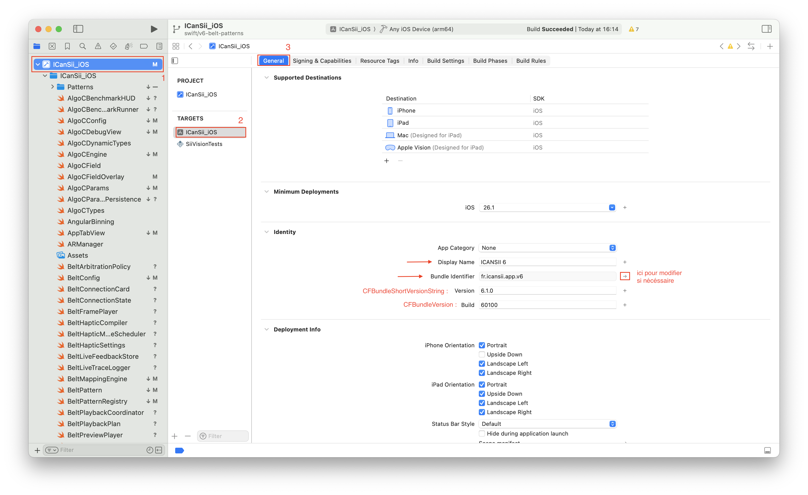
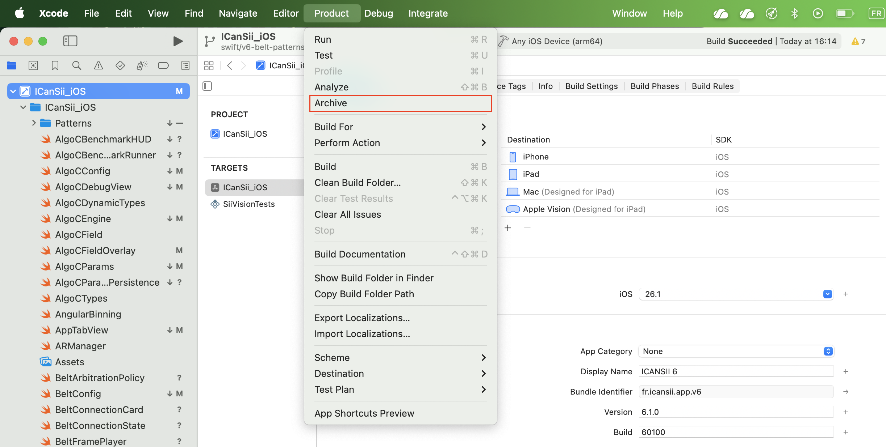
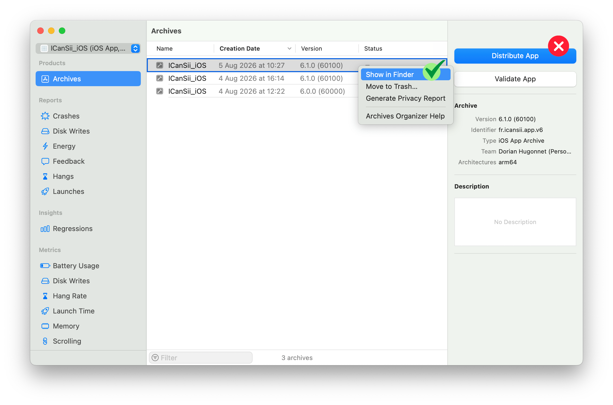
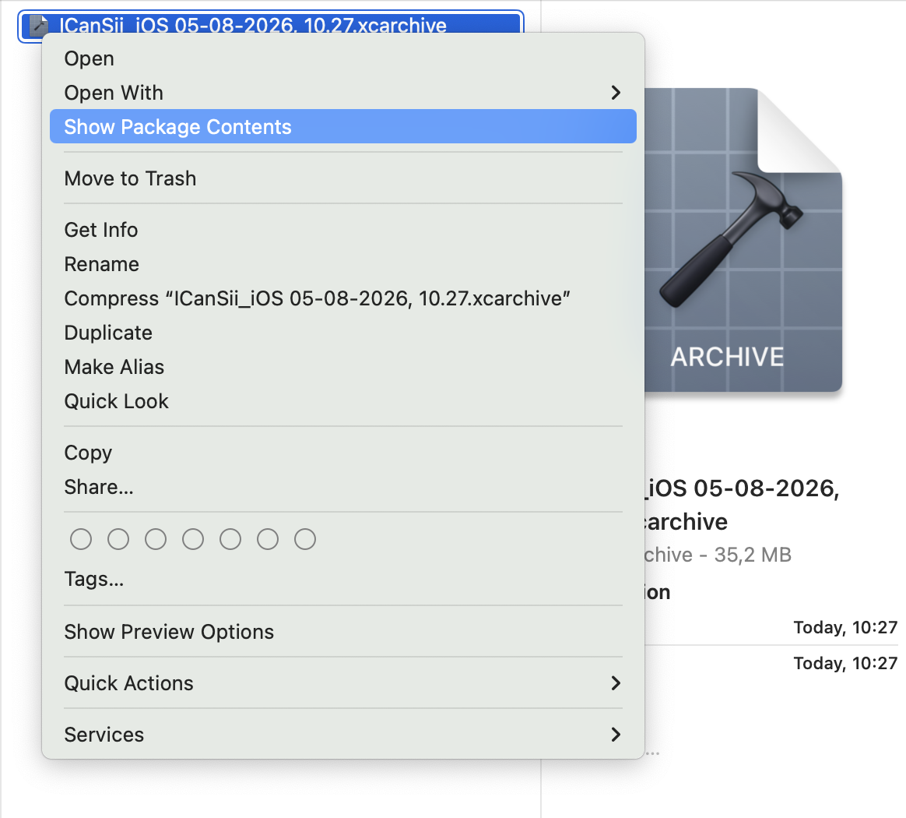
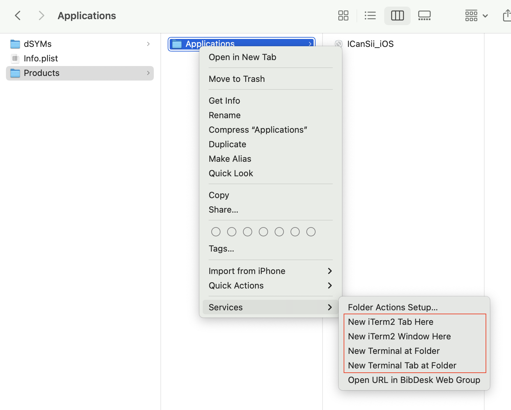

# Exporter les IPA

ICANSII 5 et ICANSII 6 sont deux applications indépendantes.

| Application | Bundle identifier | Nom d’IPA |
|---|---|---|
| ICANSII 5 | `fr.icansii.app.v5` | `ICANSII-v5.x.y.ipa` |
| ICANSII 6 | `fr.icansii.app.v6` | `ICANSII-v6.x.y.ipa` |

## Préparer Xcode

Pour chaque cible :

1. sélectionnez **Any iOS Device (arm64)** ;
2. contrôlez le bundle identifier ;
3. contrôlez `CFBundleShortVersionString` ;
4. incrémentez `CFBundleVersion` ;
5. lancez **Product → Archive**.





Le bouton **Distribute App** n’est pas utilisé avec une Personal Team gratuite.
Ouvrez plutôt le contenu du `.xcarchive`, puis
`Products/Applications/`.








## ICANSII 5.x.y

```bash
cd /path/to/V5.xcarchive/Products/Applications
# Si vous avez suivi les instructions ci-dessus, vous êtes déjà dans ce répertoire.

VERSION="5.x.y"
APP_PATH="$(find . -maxdepth 1 -name '*.app' -print -quit)"
APP_NAME="ICANSII5.app"

rm -rf Payload "$APP_NAME"
cp -R "$APP_PATH" "$APP_NAME"

/usr/libexec/PlistBuddy -c "Set :CFBundleName ICANSII5" "$APP_NAME/Info.plist"
/usr/libexec/PlistBuddy -c "Set :CFBundleDisplayName ICANSII\ 5" "$APP_NAME/Info.plist" 2>/dev/null \
  || /usr/libexec/PlistBuddy -c "Add :CFBundleDisplayName string ICANSII\ 5" "$APP_NAME/Info.plist"

mkdir -p Payload
mv "$APP_NAME" Payload/
zip -rq "ICANSII-v${VERSION}.ipa" Payload
rm -rf Payload
```

## ICANSII 6.x.y

```bash
cd /path/to/V6.xcarchive/Products/Applications
# Si vous avez suivi les instructions ci-dessus, vous êtes déjà dans ce répertoire.

VERSION="6.x.y"
APP_PATH="$(find . -maxdepth 1 -name '*.app' -print -quit)"
APP_NAME="ICANSII6.app"

rm -rf Payload "$APP_NAME"
cp -R "$APP_PATH" "$APP_NAME"

/usr/libexec/PlistBuddy -c "Set :CFBundleName ICANSII6" "$APP_NAME/Info.plist"
/usr/libexec/PlistBuddy -c "Set :CFBundleDisplayName ICANSII\ 6" "$APP_NAME/Info.plist" 2>/dev/null \
  || /usr/libexec/PlistBuddy -c "Add :CFBundleDisplayName string ICANSII\ 6" "$APP_NAME/Info.plist"

mkdir -p Payload
mv "$APP_NAME" Payload/
zip -rq "ICANSII-v${VERSION}.ipa" Payload
rm -rf Payload
```

## Contrôler les métadonnées

```bash
rm -rf /tmp/icansii-check
mkdir -p /tmp/icansii-check
unzip -q ICANSII-v6.1.12.ipa -d /tmp/icansii-check # exemple pour ICANSII 6.1.12

/usr/libexec/PlistBuddy -c "Print :CFBundleIdentifier" \
  /tmp/icansii-check/Payload/*.app/Info.plist
/usr/libexec/PlistBuddy -c "Print :CFBundleShortVersionString" \
  /tmp/icansii-check/Payload/*.app/Info.plist
/usr/libexec/PlistBuddy -c "Print :CFBundleVersion" \
  /tmp/icansii-check/Payload/*.app/Info.plist

rm -rf /tmp/icansii-check
```

Doit renvoyer (pour ICANSII 6.1.12 par exemple) :

```txt
fr.icansii.app.v6
6.1.12
60112
```

## Calculer la taille

Sous macOS :

```bash
stat -f%z ICANSII-v5.x.y.ipa
stat -f%z ICANSII-v6.x.y.ipa
```

Sous Linux :

```bash
stat -c%s ICANSII-v5.x.y.ipa
stat -c%s ICANSII-v6.x.y.ipa
```

La valeur est reportée sans guillemets dans le champ `size` de `apps.json`.
